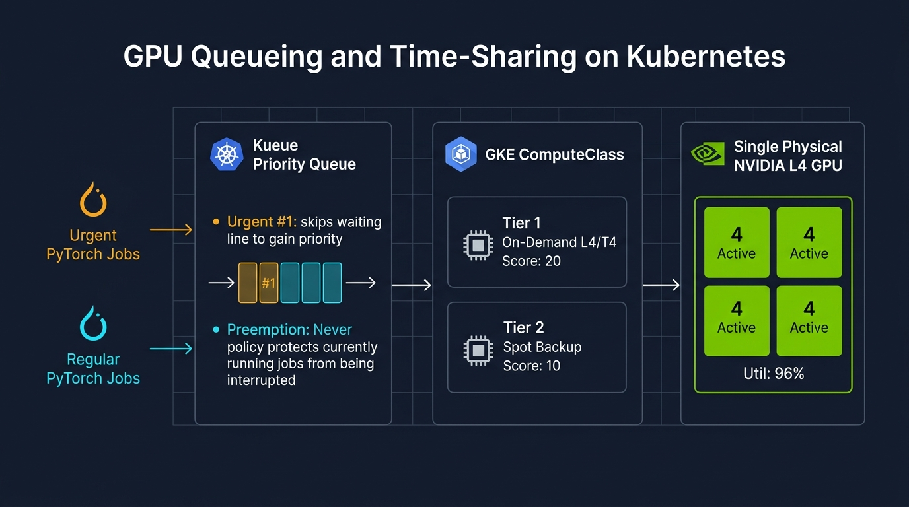

# GKE + Kueue + Custom ComputeClass (L4/T4 Time-Sharing) Demo

An interactive demonstration showing how **GKE Standard (Dataplane V2)**, **Kueue**, **Custom Compute Classes (`ComputeClass`)**, and **GPU Time-Sharing (`maxSharedClientsPerGPU: 4`)** enable cost-efficient small-model training on low-cost GPUs (`NVIDIA L4` & `Tesla T4`) while prioritizing urgent jobs over batch sweeps without wasting in-progress training runs.



---

## Why Job Queueing Is Needed on Kubernetes

Even in cloud clusters with autoscaling, GPUs are finite, quota-bound, and expensive. As explained in the official Kubernetes blog post **[Introducing Kueue](https://kubernetes.io/blog/2022/10/04/introducing-kueue/)**, plain Kubernetes falls short when multiple workloads or teams compete for batch compute:

- **Control-plane & autoscaler churn:** When a standard `batch/v1` `Job` is created, `job-controller` immediately creates Pods and `kube-scheduler` continuously retries unschedulable `Pending` Pods—which can overload the control plane at scale or trigger runaway GPU node autoscaling.
- **`ResourceQuota` rejects instead of queueing:** Native `ResourceQuota` blocks Pod creation once a limit is reached rather than holding jobs in a waiting line until capacity frees up.
- **No job-level ordering or flexible placement:** Plain Kubernetes schedules individual Pods rather than Jobs as a unit, with no built-in job queue ordering, fair-sharing across namespaces, or dynamic placement across heterogeneous hardware (On-Demand vs. Spot, `L4` vs. `T4`).
- **Kubernetes-native without replacing `kube-scheduler`:** Unlike custom batch schedulers that replace `kube-scheduler` or fragment Job APIs, **Kueue** works alongside standard Kubernetes components using native `.spec.suspend` (holding Jobs paused with zero Pods until quota is free) and mutable scheduling directives (injecting `nodeSelector` / tolerations via `ResourceFlavor` on admission).

---

## Key Highlights Demonstrated

1. **Custom Compute Class ([`k8s/01-compute-class.yaml`](k8s/01-compute-class.yaml))**:
   - **On-Demand First (`priorityScore: 20`)**: Groups `nvidia-l4` and `nvidia-tesla-t4` (`spot: false`) at `priorityScore: 20` so GKE evaluates both On-Demand GPU types concurrently and provisions whichever is available first.
   - **Spot Fallback (`priorityScore: 10`)**: Groups `nvidia-l4` and `nvidia-tesla-t4` (`spot: true`) at `priorityScore: 10` as fast backup capacity when On-Demand GPUs are constrained.
   - **GPU Time-Sharing (`TIME_SHARING`, 4 clients/GPU)**: Each physical L4 or T4 GPU exposes `4` allocatable `nvidia.com/gpu` slices so 4 small-model training jobs run concurrently on a single physical GPU, and scales back to zero when idle.
2. **Non-Preemptive Priority Scheduling ([`k8s/02-kueue-config.yaml`](k8s/02-kueue-config.yaml))**:
   - **`critical-priority` (`1000`)** vs. **`low-priority` (`100`)** via Kueue `WorkloadPriorityClass`.
   - Configured with `preemption.withinClusterQueue: Never` so running low-priority training jobs are **never evicted mid-epoch** (preventing lost training progress).
   - Newly submitted Urgent jobs immediately **jump to `#1` in the waiting queue** ahead of all pending Regular jobs and claim the very next freed GPU slice.
3. **Real PyTorch Workload & Live `nvidia-smi` Telemetry ([`k8s/03-job-templates.yaml`](k8s/03-job-templates.yaml))**:
   - Each job runs a small PyTorch training loop (`pytorch/pytorch:2.5.1-cuda12.4-cudnn9-runtime`) sized to drive ~25% GPU load, so 4 concurrent jobs push 1 shared GPU toward ~95–100% utilization.
   - In live mode, the UI streams real GPU utilization, VRAM, temperature, and power draw from `nvidia-smi` every 2 seconds.
4. **In-Cluster UI with Least-Privilege RBAC ([`k8s/04-ui-deployment.yaml`](k8s/04-ui-deployment.yaml))**:
   - Runs inside GKE under a dedicated `ServiceAccount` (`gke-queue-ui`) with scoped RBAC (`Role` for `jobs`, `pods`, `pods/log`, `pods/exec` in `default`, plus read-only `ClusterRole` on `nodes`), non-root container hardening (`UID 10001`, `readOnlyRootFilesystem: true`), and an internal `ClusterIP` `Service`.

---

## Interactive UI Views

| Route | View | What it shows |
| :--- | :--- | :--- |
| **`/`** | **Live Demo Console** | Interactive SVG scheduling diagram, job launcher, Kueue waiting line, 4 time-shared GPU seats, live `nvidia-smi` telemetry chart, and YAML manifest viewer. |
| **`/slides`** | **Intro Slides** | 7-slide deck introducing why Kubernetes needs job queueing and how Kueue + GKE `ComputeClass` work together (supports arrow keys & full-screen `F`). |
| **`/resources`** | **Queue Resources** | Interactive CRD relationship map (`Job` → `LocalQueue` → `ClusterQueue` → `WorkloadPriorityClass` → `ResourceFlavor` → `ComputeClass`) with copyable YAML & `kubectl` commands. |

---

**Prerequisites:** `gcloud`, `kubectl`, `gke-gcloud-auth-plugin`, Python 3, and L4/T4 GPU quota in your target region (defaults to `asia-southeast1`).

#### 1. Provision the GKE cluster, Kueue, and `ComputeClass`

```bash
export PROJECT_ID="your-gcp-project-id"
make setup-gke
```

[`scripts/setup-gke-cluster.sh`](scripts/setup-gke-cluster.sh) automatically:
1. Enables `container.googleapis.com` and `compute.googleapis.com`, and creates (if missing) VPC `gke-kueue-vpc` and subnet `gke-kueue-subnet` (`10.20.0.0/22`).
2. Creates a GKE Standard cluster (`gke-kueue-gpu-demo`) on the `rapid` channel with `--enable-dataplane-v2`.
3. Installs **Kueue** and waits for `kueue-controller-manager` to become available.
4. Applies [`k8s/01-compute-class.yaml`](k8s/01-compute-class.yaml) and [`k8s/02-kueue-config.yaml`](k8s/02-kueue-config.yaml).

#### 2. Build & deploy the UI in-cluster (`ServiceAccount` + RBAC + `ClusterIP`)

```bash
make deploy-ui
make port-forward-ui
```

1. [`scripts/deploy-ui.sh`](scripts/deploy-ui.sh) enables Artifact Registry & Cloud Build, builds the [`Dockerfile`](Dockerfile) remotely via `gcloud builds submit` (no local Docker daemon required), generates a random Kubernetes `Secret` (`gke-queue-ui-secret`) for CSRF protection, and rolls out [`k8s/04-ui-deployment.yaml`](k8s/04-ui-deployment.yaml).
2. Because `ServiceAccount/gke-queue-ui` has RBAC permission to create GPU `Job`s, the UI is exposed as an internal **`ClusterIP` `Service`** (`svc/gke-queue-ui`) rather than an unauthenticated public LoadBalancer, and accessed safely via IAM-authenticated `kubectl port-forward` at **http://127.0.0.1:8000**.

> **Tip:** If port `8000` is already in use locally (for example, from an earlier `make run-ui`), either stop the local process or forward to another port with `make port-forward-ui PORT=8080`.

---

## Walkthrough Flow

1. Click **Send 6 jobs** (*Research · Regular priority 100*). 4 jobs share the single physical GPU across Seats 1–4, while 2 jobs wait suspended in `training-queue`.
2. Click **Send urgent job** (*Image model retraining · Urgent priority 1000*). It jumps immediately to **`#1` in the waiting line** without stopping any of the 4 running jobs.
3. As soon as a running job finishes its training loop and frees a seat, Kueue admits the `#1` urgent job next. Watch the **GPU usage** card (`nvidia-smi`) climb as seats fill.

> **Note on cold starts:** On a live cluster scaled to zero GPU nodes, the first admitted job takes ~1–3 minutes while GKE provisions the L4/T4 VM and pulls the PyTorch runtime image. Once warm, subsequent jobs start in seconds, and GKE scales idle GPU nodes back to zero automatically after the queue drains.

---

## Configuration Overrides

All scripts respect environment variables so you can customize the region, cluster, or networking without editing files:

| Variable | Default | Description |
| :--- | :--- | :--- |
| `PROJECT_ID` | Active `gcloud` project | Target Google Cloud project ID |
| `REGION` | `asia-southeast1` | GKE cluster & Artifact Registry region |
| `CLUSTER_NAME` | `gke-kueue-gpu-demo` | GKE Standard cluster name |
| `NETWORK_NAME` | `gke-kueue-vpc` | VPC network name (created if missing) |
| `SUBNET_NAME` | `gke-kueue-subnet` | Subnet name (created if missing) |
| `SUBNET_RANGE` | `10.20.0.0/22` | Primary CIDR range for the subnet |
| `KUEUE_VERSION` | `v0.10.1` | Upstream Kueue release manifest version |
| `PORT` | `8000` | Local bind port for `make run-ui` / `make port-forward-ui` |

---

## Repository Structure

```text
.
├── app/                        # FastAPI backend + vanilla JS/CSS/SVG frontend
│   ├── main.py                 # Live GKE (kubeconfig / in-cluster) & Simulation engine
│   └── static/                 # / (live console), /slides (deck), /resources (CRD guide)
├── docs/
│   └── architecture.jpg        # End-to-end architecture overview diagram
├── k8s/
│   ├── 01-compute-class.yaml   # GKE ComputeClass (L4/T4 On-Demand & Spot + 4x TIME_SHARING)
│   ├── 02-kueue-config.yaml    # ResourceFlavor, PriorityClasses, ClusterQueue, LocalQueue
│   ├── 03-job-templates.yaml   # Standalone PyTorch Job manifests for CLI testing
│   └── 04-ui-deployment.yaml   # UI ServiceAccount, least-privilege RBAC, Deployment, ClusterIP
├── scripts/
│   ├── setup-gke-cluster.sh    # Provisions VPC, GKE Standard (Dataplane V2), Kueue & CRDs
│   ├── deploy-ui.sh            # Cloud Build + Artifact Registry + in-cluster UI rollout
│   └── cleanup-gke-cluster.sh  # Cleans up demo Jobs or tears down the GKE cluster
├── Dockerfile                  # Non-root Python 3.12 container image for in-cluster UI
└── Makefile                    # One-command targets for local & GKE workflows
```

---

## Clean Up

```bash
make clean-jobs    # Delete demo training jobs only (keeps cluster & UI running)
make destroy-gke   # Delete the GKE cluster
```

---

## Disclaimer

This code is provided "as-is" as a demonstration only to illustrate a potential solution. The code does not constitute a Google product or service of any kind, and Google offers no support, warranties, or liability of any kind with its regard. Whoever chooses to use this code accepts all responsibility related to it, including for its implementation, use, and ongoing maintenance. For the avoidance of doubt, this code is not eligible for the Google Open Source Software Vulnerability Rewards Program.
